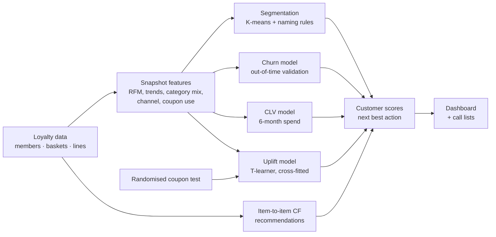

# 👥 UAE Retail Customer 360

**Know every loyalty member: which segment they belong to, how much they'll spend, whether they're
about to leave, what to recommend, and whether a coupon will actually change their behaviour.**

> Data: synthetic loyalty data for a UAE retailer: 20,000 members, 2 years of baskets
> (1.3M baskets, 5.4M line items, 48 products in 10 categories), plus a randomised A/B coupon
> campaign in April 2026. Hidden shopper personas and true campaign effects are kept separate,
> so the models can be checked against ground truth.

---

## The business questions

| Question | Approach | Output |
|---|---|---|
| Who are our customers? | RFM + shopping-mission clustering, auto-named segments | 6 segments with plain-English names |
| Who is about to leave? | Churn model (no purchase in next 90 days), validated out-of-time | Churn risk per active member |
| Who is worth the most? | CLV model: spend over the next 6 months | Predicted value per member |
| Whom do we call first? | Value at risk = churn risk × CLV | Ranked retention call list |
| What should we recommend? | Item-to-item collaborative filtering | Top-3 new products per member |
| Who should get the coupon? | Uplift modelling on the randomised test | Persuadables / sure things / sleeping dogs |

## Results

**Segments** (30 June 2026): *Family Stock-up Shoppers* are 24% of members but **63% of sales**.
Convenience Regulars, Deal Seekers and Premium Gifters follow; a third of members are Lapsed.

**Churn**: ROC-AUC **0.86** out-of-time (trained on a September 2025 snapshot, tested on December 2025).
Contacting the riskiest 20% of active members reaches **75% of the customers who actually churn**
(base churn rate 8%). Top drivers: recency, visit frequency, and falling spend.

**CLV**: mean absolute error AED 914 vs AED 1,022 for "next 6 months = last 6 months" (**11% better**),
with 0.92 rank correlation to actual future spend.

**Recommendations**: among customers who went on to buy a product they had never bought before,
**83% had it in their top-5 recommendations**, vs 65% for best-sellers (**+29%**).

**Campaign targeting** (the headline consulting finding):

| Who gets the coupon | Extra spend per targeted member | Coupon cost | Profit per 1,000 members |
|---|---|---|---|
| Everyone | AED 43 | AED 11 | **AED −184** (loses money) |
| Top 50% by predicted uplift | AED 66 | AED 12 | **AED +2,055** |
| Top 30% by predicted uplift | AED 92 | AED 17 | AED +1,860 |

The coupon lifts sales overall, but sending it to everyone **loses money**: most of the cost goes to
customers who would have bought anyway. Targeting by predicted uplift turns the same campaign profitable.
The model correctly finds Deal Seekers as most persuadable and Premium Gifters as **"sleeping dogs"**
who spend *less* when contacted (checked against the simulator's hidden personas).

Reproduce with `make pipeline` (about 3 minutes including data generation).

---

## How it works



**Next best action logic:** high value at risk → *retention call*; persuadable → *send coupon*;
sleeping dog → *do not contact*; everyone else → *personalised recommendations*.

## Quick start

```bash
git clone https://github.com/vineethasusan/Retail-Customer-360-and-personalisation.git
cd Retail-Customer-360-and-personalisation
python -m venv .venv && source .venv/bin/activate
make install
make pipeline     # outputs/report.md, outputs/customer_scores.csv
make dashboard    # http://localhost:8501
```

## Design decisions

- **Out-of-time validation everywhere.** Models train on an older snapshot and are tested on a later one, as
  they would be used in production. Features only use data before the snapshot date (tested).
- **Value at risk, not just churn risk.** A likely churner who spends AED 200 a year is less urgent than a
  medium-risk family spending AED 15,000.
- **Uplift, not response.** "Who will buy if we send a coupon?" targets people who would buy anyway.
  "Who buys *because* of the coupon?" needs a randomised test and an uplift model.
- **Count the coupon cost once.** Campaign outcome is measured at full price, and discount cost is subtracted
  separately in the profit calculation.
- **Names, not cluster numbers.** Segments are labelled from their profiles so marketing teams can use them directly.

## Project structure

```
Retail-Customer-360-and-personalisation/
├── src/cust360/
│   ├── data.py        # synthetic loyalty data + randomised campaign
│   ├── features.py    # snapshot features (no future leakage)
│   ├── segments.py    # RFM scores and named clusters
│   ├── models.py      # churn and CLV models
│   ├── recommend.py   # item-to-item collaborative filtering
│   ├── uplift.py      # T-learner uplift, Qini table, targeting policy value
│   └── pipeline.py    # end-to-end run and report
├── dashboard.py       # segments, retention list, campaign targeting, customer lookup
├── tests/
└── Dockerfile, Makefile, .github/workflows/ci.yml
```

## Roadmap

- Probabilistic CLV (BG/NBD + Gamma-Gamma) alongside the ML model
- Basket-level recommendations ("complete the basket") with association rules
- Arabic/English personalised message generation with an LLM for each next-best action
- Schedule weekly scoring and push lists to the CRM

## Author

**Vineetha Susan Alexander** · Senior Data Scientist & AI Consultant, Dubai
[LinkedIn](https://www.linkedin.com/in/vineetha-susan-alexander-465997135) · [GitHub](https://github.com/vineethasusan)

MIT License.
